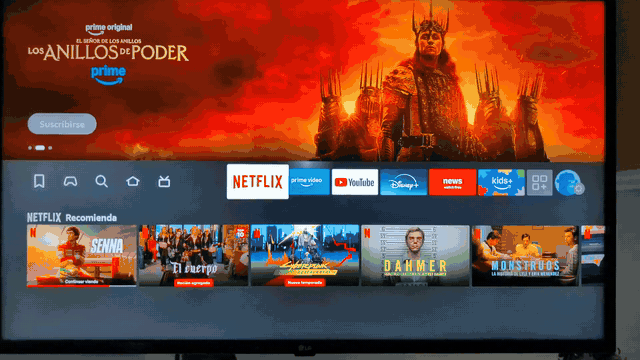
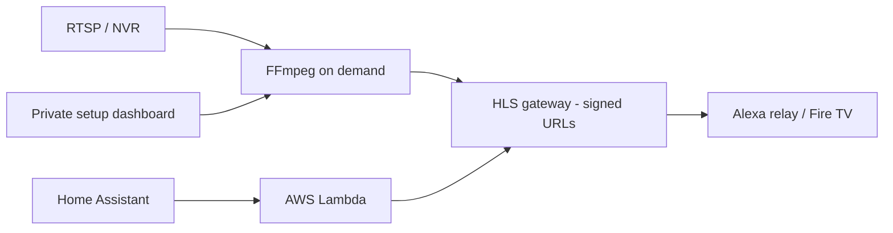

# Alexa RTSP Bridge Pro

**RTSP cameras on Home Assistant, Alexa and Fire TV — on-demand HLS, camera dashboard and guided setup.**

<p align="center"><a href="https://github.com/RenanEspinar/Alexa-RTSP-Bridge/blob/main/Alexa_RTSP_Bridge_FireTV_README_1080p.mp4"></a></p>

**[Watch original Fire TV demonstration](Alexa_RTSP_Bridge_FireTV_README_1080p.mp4)** · **[Complete installation guide (ES)](docs/GUIA_COMPLETA_ES.md)** · **[English setup guide](docs/SETUP_GUIDE_EN.md)** · **[Measured performance](docs/RENDIMIENTO_EXPERIMENTAL.md)**

> **Version:** `0.3.0b1` preview. The original Alexa installation was demonstrated on Fire TV; the Pro 0.2 engine was tested with eight real RTSP channels on Ubuntu; the 0.3 wizard and Home Assistant integration are new and must be validated on a real Home Assistant system. Do not equate these tests with an Alexa end-to-end validation of the new build.

## What it includes

| Feature | Status |
|---|---|
| RTSP → H.264/MPEG-TS HLS on demand | Implemented; Pro 0.2 tested with 8 RTSP channels |
| Start/stop of FFmpeg on request/idle | Implemented; observed during the tests |
| Camera management dashboard / RTSP probe / JPEG snapshots | Implemented; tested on Ubuntu |
| Automatic H.264 compatible copy or transcoding | Implemented; reported trial used **transcode** |
| Signed HLS playlist, segment and snapshot URLs | Implemented; local automated tests |
| 4-step setup wizard | **New in 0.3 preview; needs browser acceptance testing** |
| Home Assistant custom integration / entities | **New in 0.3 preview; not yet tested in a live HA installation** |
| Home Assistant OS app packaging | Experimental; requires HA OS testing |
| Alexa Smart Home Lambda template | Provided; use a test skill before production |

## Installation choices

**Home Assistant Container / Ubuntu Docker:** run the `alexa_bridge` gateway using `compose.pro.yml`, then install the optional Home Assistant integration. This is the method used on the author's server. The wizard is already inside the gateway web panel.

**Home Assistant OS:** the `alexa_bridge/` folder is a Home Assistant app/add-on candidate. The app and its HA integration are separate; verify the HA OS packaging before a public release.

**Home Assistant 2026.11+:** use **Settings → Marketplace → Add from link** to add this repository, then install the custom integration. Prior versions can use **HACS → Custom repositories → Integration**. **Neither method installs Docker or configures AWS automatically.** [Official Marketplace instructions](https://www.home-assistant.io/integrations/marketplace).

<!-- ha-marketplace:exclude-start -->
### Quick start: Docker (new deployment)

```bash
git clone https://github.com/RenanEspinar/Alexa-RTSP-Bridge.git
cd Alexa-RTSP-Bridge
cp .env.pro.example .env.pro
docker compose --env-file .env.pro -f compose.pro.yml config -q
docker compose --env-file .env.pro -f compose.pro.yml up --build -d
```

Open `http://127.0.0.1:18099` **from the Docker host only**; for remote access, use SSH port forwarding or Cloudflare Access. **Never expose the unauthenticated administration port directly on the Internet.** Configure Alexa and signed media using the full manual.

**Existing Pro Beta v0.2 installation:** see [upgrade without a second server](docs/MIGRAR_DESDE_V02.md). The code is updated in the current compose project, with the same named volume and existing ports.
<!-- ha-marketplace:exclude-end -->

## How it works



Amazon Alexa needs a separate Smart Home skill, account linking and an HTTPS endpoint. The gateway does not automatically provision those external accounts.

## Measurements from a real 8-channel installation

Ubuntu host, **4 logical CPUs**, approximately **7.1 GiB RAM**. One 60-second sustained trial per concurrency level, with RTSP channels originating from the same NVR, all using `transcode`:

| Concurrent channels | Mean Docker CPU | Peak Docker CPU | Peak container RAM | Unique `.ts` segments | HTTP / other errors |
|---:|---:|---:|---:|---:|---:|
| 1 | 42.90% | 82.31% | 104.1 MiB | 61 | 0 / 0 |
| 4 | 146.47% | 164.12% | 338.6 MiB | 253 | 0 / 0 |
| 8 | 190.26% | 240.52% | 678.7 MiB | 511 | 0 / 0 |

At eight channels, average time to the first TS segment was **11.474 s**; processes stopped after inactivity. **100% Docker CPU ≈ one logical CPU** (400% nominal on the 4-CPU host). Four channels showed a `max_gap_new_ts_s` over 5 s in the 8-channel trial. This metric is a client-observed gap between newly discovered segments, not proof of video freezing. Results are **preliminary** (one trial per condition, no competing baseline, no Alexa Pro 0.3 end-to-end playback data).


[**Complete measured report**](docs/RENDIMIENTO_EXPERIMENTAL.md) · [**Anonymized CSV and reproducible analysis**](benchmarks/2026-11-19/) · [**Benchmark script**](tools/benchmark_sostenido.py)

## Manuals and support

- [Complete Spanish guide](docs/GUIA_COMPLETA_ES.md) — prerequisites, installation, wizard, cameras, HA, Alexa, Cloudflare, security, troubleshooting and updates.
- [English setup guide](docs/SETUP_GUIDE_EN.md) — installation and configuration overview.
- [Alexa + AWS Lambda](docs/ALEXA_LAMBDA_ES.md) — external manual account setup and test procedure.
- [Security and privacy](docs/SEGURIDAD_ES.md).
- [Upgrade existing Pro Beta](docs/MIGRAR_DESDE_V02.md).
- [Experimental results and limitations](docs/RENDIMIENTO_EXPERIMENTAL.md).
- [Publish sources to GitHub](docs/PUBLICAR_EN_GITHUB.md).

**License:** MIT. Community project by [Renan Espinar](https://github.com/RenanEspinar), not affiliated with Amazon, Home Assistant or Cloudflare. Report reproducible issues with sanitized logs only: [GitHub Issues](https://github.com/RenanEspinar/Alexa-RTSP-Bridge/issues).
