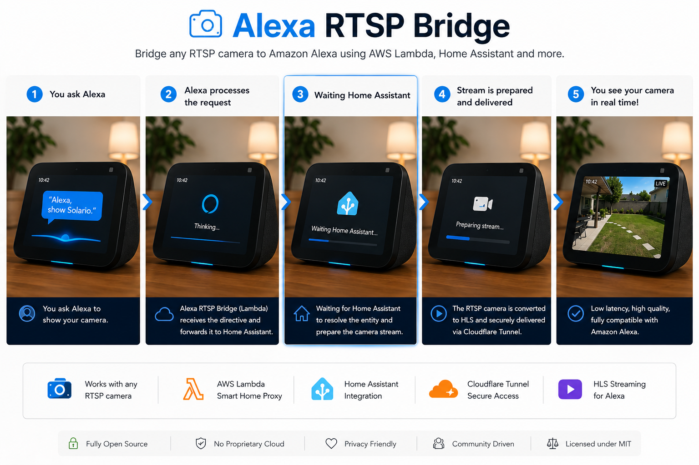
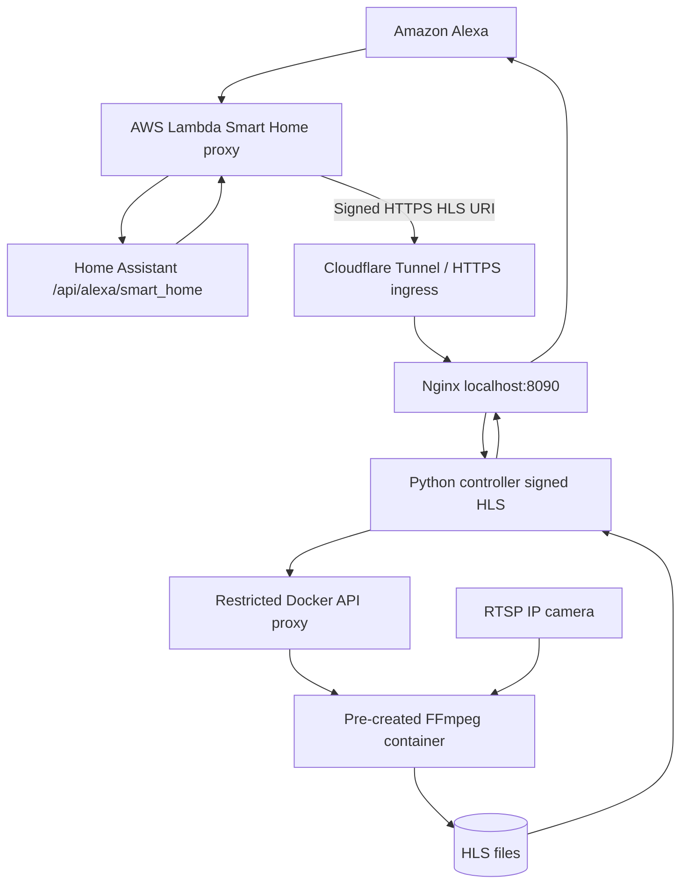

<p align="center"></p>

# Alexa RTSP Bridge — reproducible deployment candidate

**Alexa Smart Home + Home Assistant + RTSP cameras + FFmpeg + on-demand HLS + Docker**

This package is a **release candidate**, not a certified or universally tested installer. It is based on the author's operating setup and includes a **new public distribution** with configurable cameras, private RTSP URL files, a Docker Compose generator, on-demand FFmpeg containers, and short-lived signed HLS links. The new distribution has been statically tested, but **end-to-end AWS/Alexa and Docker deployment still require external testing**.

> **Current stable upstream:** [GitHub repository](https://github.com/RenanEspinar/Alexa-RTSP-Bridge) · [Original v0.1.0 release](https://github.com/RenanEspinar/Alexa-RTSP-Bridge/releases/tag/v0.1.0). This proposal has **not** been merged into the public `main` branch.

## What it actually does

1. An Alexa Smart Home skill sends a camera request to AWS Lambda.
2. Lambda forwards the request to Home Assistant's Alexa Smart Home endpoint.
3. For recognized camera endpoints, Lambda replaces the camera stream URL with a signed HTTPS HLS link.
4. Cloudflare Tunnel (or another HTTPS ingress) routes the HLS request to local Nginx.
5. Nginx proxies the request to the on-demand controller. The controller validates the HMAC signature and starts a pre-created FFmpeg Docker container only when its playlist is requested.
6. FFmpeg reads the configured RTSP camera and publishes 960×540 H.264 HLS at 15 fps, 1000 kb/s. The controller serves playlist and segments.
7. After **30 seconds since the last playlist request** (default), the watchdog stops that camera container. This is an idle heuristic, **not** an Alexa disconnect signal.

### Architecture



## Quick navigation

- **[Full installation walkthrough](docs/INSTALL.md)** — Ubuntu, Docker, multiple cameras, local checks, Cloudflare, Home Assistant and Alexa.
- **[Alexa / AWS Lambda configuration](docs/ALEXA_AWS.md)** — skill configuration, environment variables and mapping.
- **[Architecture and real-server differences](docs/ARCHITECTURE.md)** — operating system evidence, original design and release-candidate changes.
- **[Security and privacy](docs/SECURITY.md)** — signing keys, temporary URLs, Docker socket risks, leaks and rotation.
- **[Validation checklist](docs/VALIDATION.md)** — objective acceptance criteria, manual tests and limitations.
- **[Troubleshooting](docs/TROUBLESHOOTING.md)** — 403, 404, 503, FFmpeg and Alexa issues.
- **[Visual documentation](docs/MEDIA.md)** — original photos/videos and screenshots needed for Reddit.

## Minimal setup overview

```bash
cp .env.example .env
cp config/cameras.example.json config/cameras.json
mkdir -p local/secrets local/hls
chmod 700 local/secrets
openssl rand -hex 32 > local/secrets/hls_signing_key
chmod 600 local/secrets/hls_signing_key
# Create one local/secrets/<slug>.url containing your private RTSP URL for each camera.
# Configure config/cameras.json and then run:
python3 tools/configure.py
python3 -m unittest discover -s tests -v
# Inspect generated files; then, on an ISOLATED TEST HOST:
docker compose -f compose.generated.yml --profile camera create
docker compose -f compose.generated.yml up -d dockerproxy controller nginx
```

**Do not run these deployment commands on the author's live homeserver.** Run them on a second host or isolated test VM after reading the full guide. Compose generates new container names and may conflict with an existing deployment if used on the same Docker daemon.

## Supported vs unverified

| Capability | Evidence level |
|---|---|
| Original eight-camera on-demand controller | Confirmed in author's server code/configuration; runtime containers were inactive at the audit instant |
| Original FFmpeg encoding profile | Confirmed from server `start-camera.sh` |
| Original Nginx routing | `nginx -T` syntax passed on the author's running container |
| Public configurable camera generator | Implemented in this package; unit-tested locally |
| Signed HLS URLs | Implemented and locally unit-tested; live Alexa verification pending |
| Any Hikvision/Dahua/Reolink/NVR/any device | **Not tested as a compatibility matrix** |
| Raspberry Pi / other CPU architectures | **Not verified in this release candidate** |
| Alexa app/Echo Show end-to-end | **Must be validated in user's environment** |

## Prerequisites

Linux server with Docker Engine and Docker Compose, a reachable RTSP camera, Home Assistant with Alexa Smart Home integration, an AWS account with Lambda, an Amazon Developer account/skill, and a publicly accessible HTTPS ingress that supports long-running HLS. Running FFmpeg transcoding needs CPU capacity; a single 960×540 15 fps stream is the baseline, not a guaranteed resource footprint.

## Credits and responsible disclosure

Developed by Renan Espinar. Open-source work; no affiliation with Amazon, Alexa, Cloudflare, Home Assistant, or camera vendors. Maintain the [MIT license](LICENSE) from the original repository when integrating this overlay. If you discover a vulnerability, avoid posting credentials or private camera feeds in public issues.

**Help improve this project:** report the camera model, RTSP codec, host CPU, Docker/FFmpeg versions, Alexa hardware, reproducible steps, and sanitized logs. Star the repository if useful; follow [@RenanEspinar](https://github.com/RenanEspinar) for engineering and IoT updates.
