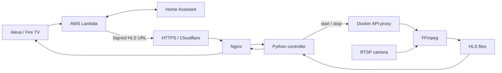

<p align="center"></p>
<h1 align="center">Alexa RTSP Bridge</h1>
<p align="center"><b>View RTSP cameras on Alexa and Fire TV, with FFmpeg running only when needed.</b></p>

<p align="center">
  <a href="https://github.com/RenanEspinar/Alexa-RTSP-Bridge/blob/main/Alexa_RTSP_Bridge_FireTV_README_1080p.mp4">
    
  </a>
</p>
<p align="center"><a href="https://github.com/RenanEspinar/Alexa-RTSP-Bridge/blob/main/Alexa_RTSP_Bridge_FireTV_README_1080p.mp4"><b>▶ Watch the full Fire TV recording (1080p)</b></a></p>
<p align="center"><sub>Real footage from my running installation. GIF sped up for the preview.</sub></p>

<p align="center">
  <a href="docs/INSTALL.md">Install</a> · <a href="docs/ALEXA_AWS.md">Alexa + AWS</a> · <a href="docs/ARCHITECTURE.md">Architecture</a> · <a href="docs/VALIDATION.md">Tests</a> · <a href="docs/SECURITY.md">Security</a>
</p>


[](https://github.com/RenanEspinar/Alexa-RTSP-Bridge/actions/workflows/static-checks.yml)

## Why I built it

I already had RTSP cameras in Home Assistant, but wanted to open them from Fire TV by asking Alexa. I didn't want to replace the cameras or keep eight FFmpeg processes transcoding all day.

The setup I run at home uses Home Assistant, AWS Lambda, Docker, Nginx and FFmpeg. The video above is from that system.

**This branch is RC1**, a more configurable version of the same idea. It adds signed HLS links and generates the camera containers from a JSON file. Its Python unit tests pass; a clean Docker deployment and the complete AWS/Alexa path still need to be tested. If you're looking for the original project, see [main](https://github.com/RenanEspinar/Alexa-RTSP-Bridge).

## How the stream starts

<p align="center"></p>



When Alexa asks for a camera, Lambda sends the request to Home Assistant and replaces the camera stream URI with our HLS endpoint. Opening that playlist starts a pre-created FFmpeg container. After **30 seconds without another playlist request**, the controller stops it. That timeout is based on playlist traffic, not a disconnect event from Alexa.

My reference FFmpeg profile is **H.264 Baseline, 960 × 540, 15 fps, 1,000 kbit/s, no audio**, with one-second HLS segments. Those settings work in my environment, but different cameras and hosts need testing.

## Trying RC1

Use a separate Docker host or VM for your first test. **Don't replace a working installation with RC1 yet.**

```bash
git clone --branch review/reproducible-rc1-20261118 \
  https://github.com/RenanEspinar/Alexa-RTSP-Bridge.git
cd Alexa-RTSP-Bridge

cp .env.example .env
cp config/cameras.example.json config/cameras.json
mkdir -p local/secrets local/hls
chmod 700 local/secrets
openssl rand -hex 32 > local/secrets/hls_signing_key
chmod 600 local/secrets/hls_signing_key

# Edit config/cameras.json and create one private .url file per camera.
# Example: local/secrets/front_door.url, with permissions 600.
python3 tools/configure.py
python3 -m unittest discover -s tests -v
docker compose -f compose.generated.yml config -q

# Only on a separate test host:
docker compose -f compose.generated.yml --profile camera create
docker compose -f compose.generated.yml up -d dockerproxy controller nginx
```

See the [installation guide](docs/INSTALL.md) for RTSP secrets, Alexa endpoint IDs, HTTPS setup and the validation steps. Don't add your `local/` folder or private camera URLs to Git.

## Docs

| File | Details |
|---|---|
| [INSTALL.md](docs/INSTALL.md) | Docker setup, local HLS test and HTTPS access |
| [ALEXA_AWS.md](docs/ALEXA_AWS.md) | Home Assistant Smart Home, Lambda and endpoint mapping |
| [ARCHITECTURE.md](docs/ARCHITECTURE.md) | Where each request goes, and what's different from my server |
| [SECURITY.md](docs/SECURITY.md) | Docker permissions, RTSP passwords and signed URLs |
| [VALIDATION.md](docs/VALIDATION.md) | What we've tested and what still needs work |
| [TROUBLESHOOTING.md](docs/TROUBLESHOOTING.md) | Common HLS and container errors |

## What has been checked?

- **Working:** the original installation can open cameras on Fire TV; that's what the video shows.
- **Inspected:** the original controller, FFmpeg settings and Nginx configuration.
- **Unit-tested:** RC1's camera generator, URL signing and Lambda response rewrite.
- **Not yet tested:** a fresh RC1 Docker deployment, full Alexa playback with RC1, hardware compatibility and third-party installation.

The CI workflow checks Python/Bash syntax and unit tests; it doesn't verify playback on real hardware.

## A couple of common questions

<details><summary>Does it always run FFmpeg?</summary>

No. FFmpeg starts on the first HLS playlist request and stops after the playlist goes idle.

</details>

<details><summary>Why don't all my cameras have thumbnails in Fire TV?</summary>

Fire TV manages those previews. The bridge provides live HLS and doesn't guarantee thumbnail generation or caching.

</details>

<details><summary>Does any RTSP camera work?</summary>

Not guaranteed. The source codec, credentials, FFmpeg image and available CPU all matter. I haven't tested a vendor compatibility matrix or Raspberry Pi support for RC1.

</details>

## Contributing

If you try this with another RTSP camera, I'd like to know the model, input codec, host hardware, first-frame delay and whether FFmpeg stops properly. Open an [issue](https://github.com/RenanEspinar/Alexa-RTSP-Bridge/issues) with sanitized logs. Please don't post live URLs or screenshots from private cameras.

Built by [Renan Espinar](https://github.com/RenanEspinar). [MIT license](LICENSE). Not affiliated with Amazon, Alexa, Home Assistant or Cloudflare.
