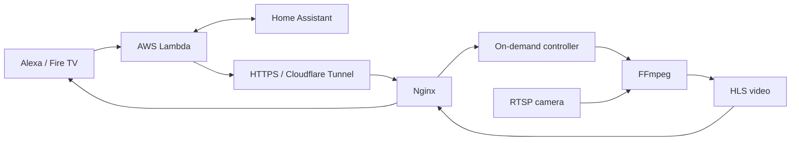

<h1 align="center">Alexa RTSP Bridge</h1>

<b>RTSP cameras on Amazon Alexa and Fire TV, with HLS created on demand.</b>

  

<a href="Alexa_RTSP_Bridge_FireTV_README_1080p.mp4"><b>▶ Watch the Fire TV demo</b></a> · <a href="https://github.com/RenanEspinar/Alexa-RTSP-Bridge/tree/review/reproducible-rc1-20261118"><b>Try the experimental RC1</b></a>

## Why I made this

I already had several RTSP cameras in Home Assistant. I wanted to see them on my Fire TV using Alexa, without buying different cameras or leaving FFmpeg running for every feed.

This project connects Alexa's camera-stream requests to Home Assistant, rewrites the HLS URL in AWS Lambda and starts the relevant FFmpeg container when someone asks for video. The container stops again after **30 seconds without a playlist request**.

The video above is from my real installation. I have eight cameras configured. This is a personal open-source project, not a certified Alexa integration or a universal camera compatibility guarantee.

## How it works

The default reference video profile is H.264 Baseline at **960 × 540 / 15 fps / 1 Mbit/s**. Audio is disabled. The live HLS playlist contains six one-second segments.

**One thing to know:** this `main` branch contains my original examples and documentation. It's not a one-command setup for someone else's server.

## Want to install it?

I'm preparing a configurable deployment in the **[RC1 branch](https://github.com/RenanEspinar/Alexa-RTSP-Bridge/tree/review/reproducible-rc1-20261118)**. That branch includes:

- [Installation instructions](https://github.com/RenanEspinar/Alexa-RTSP-Bridge/blob/review/reproducible-rc1-20261118/docs/INSTALL.md)
- [AWS Lambda + Alexa setup](https://github.com/RenanEspinar/Alexa-RTSP-Bridge/blob/review/reproducible-rc1-20261118/docs/ALEXA_AWS.md)
- [Private RTSP configuration + Compose generator](https://github.com/RenanEspinar/Alexa-RTSP-Bridge/tree/review/reproducible-rc1-20261118/tools)
- [Security notes](https://github.com/RenanEspinar/Alexa-RTSP-Bridge/blob/review/reproducible-rc1-20261118/docs/SECURITY.md)
- [Test checklist](https://github.com/RenanEspinar/Alexa-RTSP-Bridge/blob/review/reproducible-rc1-20261118/docs/VALIDATION.md)

**RC1 is experimental.** Its automated checks pass, but deploying it from scratch and reproducing Alexa playback on another device remain unverified. Please don't deploy it over a working installation without testing.

The [earlier detailed README](docs/ORIGINAL_README.md) is archived for reference. It describes the original setup and includes examples that may need adaptation.

## Things worth testing

Different RTSP cameras and input codecs; first-frame delay; stream startup after Docker restarts; HLS segment behavior on slow networks; and Fire TV thumbnail behavior. I've also seen that an out-of-date Docker socket mount can break camera startup until the controller container is restarted.

If you have a reproducible issue or a working setup with another camera model, open an [issue](https://github.com/RenanEspinar/Alexa-RTSP-Bridge/issues). Sanitized logs are much more useful than screenshots of secrets.

## License

MIT — see [LICENSE](LICENSE). Built by [Renan Espinar](https://github.com/RenanEspinar). Not affiliated with Amazon, Alexa, Home Assistant or Cloudflare.
