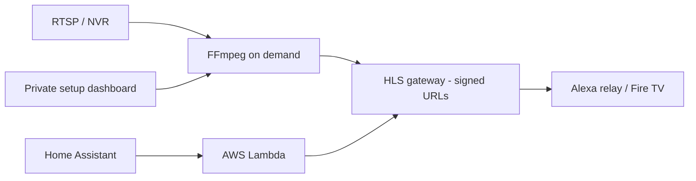

# Alexa RTSP Bridge Pro

**RTSP cameras on Home Assistant, Alexa and Fire TV — on-demand HLS, optional AAC, diagnostics, recovery, guided installation and an opt-in OpenCV/YOLOX AI detector.**

<p align="center"><a href="https://github.com/RenanEspinar/Alexa-RTSP-Bridge/blob/main/Alexa_RTSP_Bridge_FireTV_README_1080p.mp4"></a></p>

**[Pro Max AI v0.6 guide (ES)](docs/PRO_AI_V06_ES.md)** · **[Audio, diagnostics & recovery (ES)](docs/AUDIO_DIAGNOSTICOS_ES.md)** · **[AI viewer / Road mode (ES)](docs/AI_VISOR_V061_ES.md)** · **[First-time beginner installation (ES)](docs/WIZARD_DESDE_CERO_ES.md)** · **[Beginner setup (EN)](docs/START_FROM_ZERO_EN.md)** · **[Watch original Fire TV demonstration](Alexa_RTSP_Bridge_FireTV_README_1080p.mp4)** · **[Complete installation guide (ES)](docs/GUIA_COMPLETA_ES.md)** · **[English setup guide](docs/SETUP_GUIDE_EN.md)** · **[Measured performance](docs/RENDIMIENTO_EXPERIMENTAL.md)**

> **Version:** `0.6.1b1` experimental optional AI beta. The original Alexa installation was demonstrated on Fire TV; the Pro 0.2 engine was tested with eight real RTSP channels on Ubuntu; the guided-install wizard and Home Assistant integration are new and must be validated on a real Home Assistant system. Do not equate these tests with an Alexa end-to-end validation of the new build.

## What it includes

| Feature | Status |
|---|---|
| RTSP → H.264/MPEG-TS HLS on demand | Implemented; Pro 0.2 tested with 8 RTSP channels |
| Start/stop of FFmpeg on request/idle | Implemented; observed during the tests |
| Camera audio: OFF by default, AAC on demand | **New 0.5; FFmpeg/Lambda integration unit-tested, Alexa device tests pending** |
| Diagnostics: audio/video probe, local TS decode, CPU/RAM and events | **New 0.5; local tests passed** |
| Recovery: frozen segment detection, exponential backoff, per-camera restart | **New 0.5; simulated tests passed, long-running field tests pending** |
| Camera management dashboard / RTSP probe / JPEG snapshots | Implemented; tested on Ubuntu |
| Automatic H.264 compatible copy or transcoding | Implemented; reported trial used **transcode** |
| Signed HLS playlist, segment and snapshot URLs | Implemented; local automated tests |
| 11-step guided installation wizard | **New in 0.4 beta; local logic tested, end-to-end Alexa setup still unverified** |
| Home Assistant custom integration / entities | **New in 0.3 preview; not yet tested in a live HA installation** |
| Home Assistant OS app packaging | Experimental; requires HA OS testing |
| Alexa Smart Home Lambda template | Provided; use a test skill before production |
| Optional OpenCV + YOLOX-Nano + Norfair AI | **New 0.6; AI OFF by default; real RTSP detection pending field testing** |
| Event snapshots and user confirmation | Implemented as a private admin feature; local tests passed |
| Optional Home Assistant AI events/mobile notification | Implemented; requires private HA token and deployment test |

## New in v0.6: optional AI detector

The regular gateway remains unchanged for Alexa playback. To add person/vehicle/pet detection, use the separate `ai` Docker Compose profile and a SHA-256-pinned official YOLOX-Nano model; see **[step-by-step AI manual](docs/PRO_AI_V06_ES.md)**. The AI worker has no public port, analyzes up to two cameras in the CPU-safe beta, and stores evidence and confirmation feedback in the original private Docker volume. CPU/memory-limited to 0.75 core and 768 MiB. **There is no automatic Alexa TTS overlay in v0.6.**

## Installation choices

**Home Assistant Container / Ubuntu Docker:** run the `alexa_bridge` gateway using `compose.pro.yml`, then install the optional Home Assistant integration. This is the method used on the author's server. The 11-step guided installation wizard is inside the gateway web panel and links to official Amazon, AWS, Cloudflare and Home Assistant documentation.

**Home Assistant OS:** the `alexa_bridge/` folder is a Home Assistant app/add-on candidate. The app and its HA integration are separate; verify the HA OS packaging before a public release.

**Home Assistant 2026.11+:** use **Settings → Marketplace → Add from link** to add this repository, then install the custom integration. Prior versions can use **HACS → Custom repositories → Integration**. **Neither method installs Docker or configures AWS automatically.** [Official Marketplace instructions](https://www.home-assistant.io/integrations/marketplace).

<!-- ha-marketplace:exclude-start -->
### Quick start: Docker (new deployment)

```bash
git clone https://github.com/RenanEspinar/Alexa-RTSP-Bridge.git
cd Alexa-RTSP-Bridge
cp .env.pro.example .env.pro
docker compose --env-file .env.pro -f compose.pro.yml config -q
docker compose --env-file .env.pro -f compose.pro.yml up --build -d
```

Open `http://127.0.0.1:18099` **from the Docker host only**; for remote access, use SSH port forwarding or Cloudflare Access. **Never expose the unauthenticated administration port directly on the Internet.** Configure Alexa and signed media using the full manual.

**Existing Pro Beta v0.2 installation:** see [upgrade without a second server](docs/MIGRAR_DESDE_V02.md). The code is updated in the current compose project, with the same named volume and existing ports.
<!-- ha-marketplace:exclude-end -->

## How it works



Amazon Alexa needs a separate Smart Home skill, account linking and an HTTPS endpoint. The gateway does not automatically provision those external accounts.

## Measurements from a real 8-channel installation

Ubuntu host, **4 logical CPUs**, approximately **7.1 GiB RAM**. One 60-second sustained trial per concurrency level, with RTSP channels originating from the same NVR, all using `transcode`:

| Concurrent channels | Mean Docker CPU | Peak Docker CPU | Peak container RAM | Unique `.ts` segments | HTTP / other errors |
|---:|---:|---:|---:|---:|---:|
| 1 | 42.90% | 82.31% | 104.1 MiB | 61 | 0 / 0 |
| 4 | 146.47% | 164.12% | 338.6 MiB | 253 | 0 / 0 |
| 8 | 190.26% | 240.52% | 678.7 MiB | 511 | 0 / 0 |

At eight channels, average time to the first TS segment was **11.474 s**; processes stopped after inactivity. **100% Docker CPU ≈ one logical CPU** (400% nominal on the 4-CPU host). Four channels showed a `max_gap_new_ts_s` over 5 s in the 8-channel trial. This metric is a client-observed gap between newly discovered segments, not proof of video freezing. Results are **preliminary** (one trial per condition, no competing baseline, no Alexa Pro 0.3 end-to-end playback data).


[**Complete measured report**](docs/RENDIMIENTO_EXPERIMENTAL.md) · [**Anonymized CSV and reproducible analysis**](benchmarks/2026-11-19/) · [**Benchmark script**](tools/benchmark_sostenido.py)

## Beginner installation

Open **Install wizard** in the gateway dashboard. The 11 stages cover prerequisites, adding a camera, testing RTSP/JPEG/HLS, Home Assistant, Cloudflare, Skill creation, Lambda, environment variables, OAuth, actual Alexa playback and final checks. The UI gives official links and copyable values; it **does not automatically create AWS or Amazon accounts**, and completion checkboxes are manual. Read [Español: desde cero](docs/WIZARD_DESDE_CERO_ES.md) or [English: first-time setup](docs/START_FROM_ZERO_EN.md).

## Manuals and support

- [Complete Spanish guide](docs/GUIA_COMPLETA_ES.md) — prerequisites, installation, wizard, cameras, HA, Alexa, Cloudflare, security, troubleshooting and updates.
- [English setup guide](docs/SETUP_GUIDE_EN.md) — installation and configuration overview.
- [Alexa + AWS Lambda](docs/ALEXA_LAMBDA_ES.md) — external manual account setup and test procedure.
- [Security and privacy](docs/SEGURIDAD_ES.md).
- [Upgrade existing Pro Beta](docs/MIGRAR_DESDE_V02.md).
- [Experimental results and limitations](docs/RENDIMIENTO_EXPERIMENTAL.md).
- [Publish sources to GitHub](docs/PUBLICAR_EN_GITHUB.md).

**License:** MIT. Community project by [Renan Espinar](https://github.com/RenanEspinar), not affiliated with Amazon, Home Assistant or Cloudflare. Report reproducible issues with sanitized logs only: [GitHub Issues](https://github.com/RenanEspinar/Alexa-RTSP-Bridge/issues).


## Audio and recovery (v0.5 preview)

In **Cameras → Edit**, choose **Audio OFF** (default) or **AAC** for each camera. AAC requires an audio track on the camera's RTSP channel; **Probe A/V** in Diagnostics checks it. When the source has no audio, leave the setting OFF. After enabling AAC, copy the refreshed endpoint map into your *private* Lambda configuration and redeploy the test Lambda before using Alexa.

The gateway checks playlist and segment freshness for active streams, restarts stalled workers after a cooldown, and records sanitized events. **Diagnostics** shows resource counters, start/recovery attempts, segment age, and a local TS decode test. Credentials and signed streaming URLs are excluded from those results.

**Important:** disabling camera audio does not guarantee that music continues playing on Fire TV. Camera navigation and Alexa's media/audio focus can still interrupt other apps. The v0.5 features have not been compared experimentally with other bridges, and the published eight-camera CPU/RAM benchmark was measured on the older, video-only v0.2 build.
