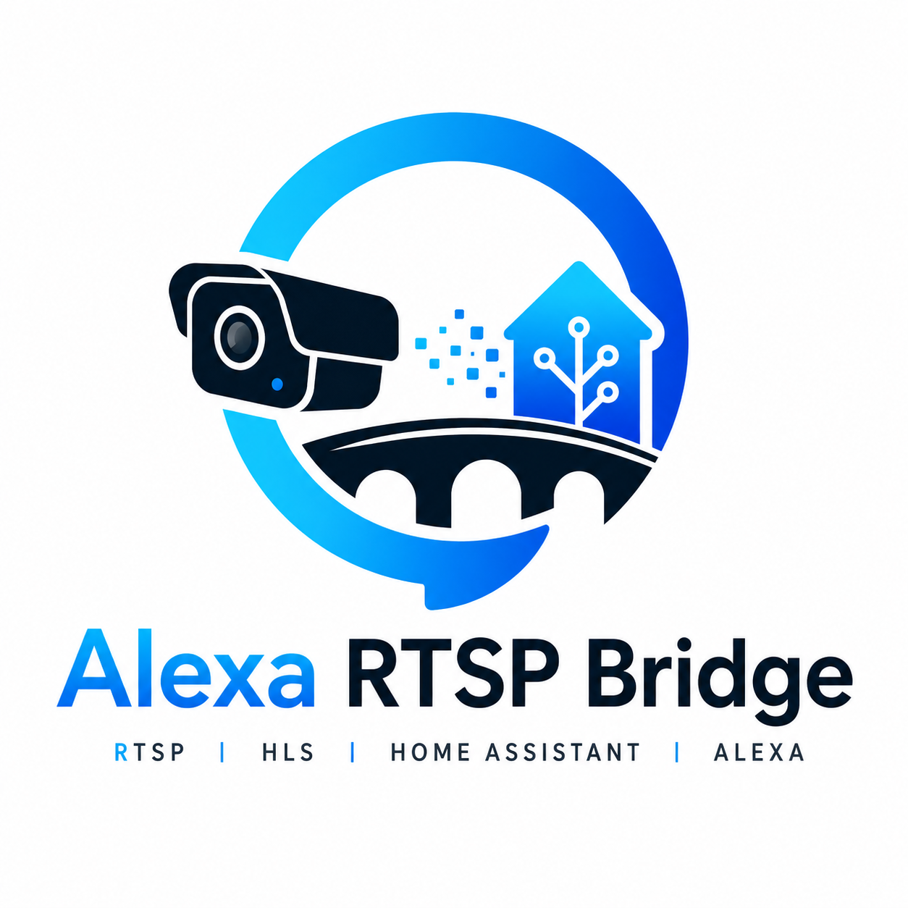
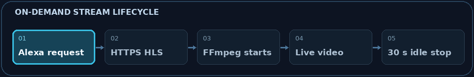
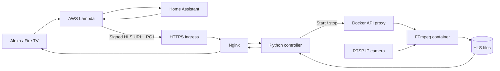

<p align="center"></p>

<h1 align="center">Alexa RTSP Bridge</h1>

<p align="center"><strong>RTSP cameras on Amazon Alexa and Fire TV — with on-demand HLS streaming</strong></p>

[](https://github.com/RenanEspinar/Alexa-RTSP-Bridge/actions/workflows/static-checks.yml?query=branch%3Areview%2Freproducible-rc1-20261118)


<h3 align="center">See it running on a real Fire TV</h3>

<p align="center"><a href="https://github.com/RenanEspinar/Alexa-RTSP-Bridge/blob/main/Alexa_RTSP_Bridge_FireTV_README_1080p.mp4"></a></p>

<p align="center"><strong><a href="https://github.com/RenanEspinar/Alexa-RTSP-Bridge/blob/main/Alexa_RTSP_Bridge_FireTV_README_1080p.mp4">▶ Watch the complete Fire TV demonstration (1080p, 20.7 s)</a></strong></p>

<p align="center"><sub>Real footage of the author's existing installation. The animated preview is accelerated 1.6× and has no audio; the full recording is linked above. This footage does not validate the new RC1 deployment.</sub></p>

<p align="center"><a href="docs/INSTALL.md">Installation</a> · <a href="docs/ALEXA_AWS.md">Alexa / AWS</a> · <a href="docs/ARCHITECTURE.md">Architecture</a> · <a href="docs/SECURITY.md">Security</a> · <a href="docs/VALIDATION.md">Test matrix</a></p>

---

## What this project does

Alexa RTSP Bridge connects an **existing RTSP camera** to Alexa's camera-stream workflow using **Home Assistant, AWS Lambda, FFmpeg, Docker, and HTTPS HLS**. The original eight-camera installation has been demonstrated on Fire TV.

The **RC1 branch** is a separate, configurable implementation derived from that installation. It adds per-camera RTSP secret files, generated Docker Compose services, a camera controller, and **HMAC-signed, expiring HLS URLs**. It is **experimental**: automated checks pass, but a fresh Docker installation and end-to-end Alexa playback of *RC1 itself* remain unverified.

<p align="center"></p>

### Stream lifecycle

1. Alexa sends a `CameraStreamController` directive to the **AWS Lambda Smart Home proxy**.
2. Lambda forwards it to **Home Assistant**, receives the camera response, and substitutes the configured HLS URI. **RC1** signs that URI with an expiry timestamp.
3. HTTPS ingress (for example, **Cloudflare Tunnel**) routes the playlist request to **Nginx**, then to the Python controller.
4. The controller validates the signature, starts the camera's pre-created **FFmpeg** container, and serves the HLS playlist and video segments.
5. After **30 seconds without another playlist request** (configurable), the watchdog stops that container. This is an inactivity heuristic, **not** a true Alexa disconnect event.



### Baseline encoding profile

| Setting | Reference value |
|:--|:--|
| Video | H.264 / AVC, Baseline profile |
| Frame size | **960 × 540** pixels |
| Frame rate | **15 fps** |
| Video bitrate | **1,000 kbit/s** target |
| HLS segments | **1 second** each; 6-segment live playlist |
| Audio | Disabled (`-an`) |
| Inactivity timeout | **30 s** since last playlist request |

These are settings recovered from the author's original installation. They are not universal performance or compatibility guarantees.

## Getting started with RC1

**Requirements:** Linux, Docker Engine and Docker Compose, Python 3, OpenSSL, RTSP camera access, Home Assistant configured for Alexa Smart Home, AWS Lambda, an Alexa Smart Home skill, and a publicly reachable **HTTPS** route to the HLS server.

> **Use an isolated test VM or host.** The original homeserver must not be replaced with this release candidate until Docker, Alexa, security, and recovery tests pass. **Do not copy real RTSP credentials into a public repository.**

```bash
# Clone the experimental branch on a separate test host.
git clone --branch review/reproducible-rc1-20261118 \
  https://github.com/RenanEspinar/Alexa-RTSP-Bridge.git
cd Alexa-RTSP-Bridge

# Prepare local-only camera definitions and signing material.
cp .env.example .env
cp config/cameras.example.json config/cameras.json
mkdir -p local/secrets local/hls
chmod 700 local/secrets
openssl rand -hex 32 > local/secrets/hls_signing_key
chmod 600 local/secrets/hls_signing_key

# Edit config/cameras.json and create local/secrets/<slug>.url
# for each camera. Each private .url file contains one RTSP URL.
# chmod 600 local/secrets/<slug>.url

python3 tools/configure.py
python3 -m unittest discover -s tests -v
docker compose -f compose.generated.yml config -q

# ISOLATED TEST HOST ONLY: create the camera containers stopped,
# then start the control and HTTP services.
docker compose -f compose.generated.yml --profile camera create
docker compose -f compose.generated.yml up -d dockerproxy controller nginx
```

The `alexa_endpoint_id` entries in `config/cameras.json` must match the endpoint IDs reported by your Home Assistant Alexa integration. See **[the complete installation manual](docs/INSTALL.md)** before running these commands.

### Complete documentation

| Guide | What it covers |
|:--|:--|
| [Installation](docs/INSTALL.md) | Camera setup, Docker Compose generation, local validation and HTTPS ingress |
| [Alexa & AWS](docs/ALEXA_AWS.md) | Lambda proxy, skill integration, endpoint mapping |
| [Architecture](docs/ARCHITECTURE.md) | Original server vs. RC1 implementation; component boundaries |
| [Security](docs/SECURITY.md) | HLS signing, RTSP secret files, Docker API proxy limitations |
| [Validation](docs/VALIDATION.md) | Acceptance tests and evidence requirements |
| [Troubleshooting](docs/TROUBLESHOOTING.md) | 403 / 404 / 503, RTSP failures and container startup |
| [Media](docs/MEDIA.md) | Real footage, screenshots and evidence collection |

## Verified vs. pending

| Capability | Current status |
|:--|:--|
| Original Fire TV camera playback | **Demonstrated** in the linked footage |
| Original on-demand controller and eight configured camera containers | **Inspected** on the author's homeserver |
| Original Nginx configuration | **Syntax verified** on the running instance |
| RC1 camera/Compose generator | **Unit-tested** locally |
| RC1 HMAC links and Lambda response transformation | **Unit-tested** locally |
| New installation on a clean Docker host | **Pending** |
| RC1 full Alexa / AWS / Fire TV playback | **Pending** |
| Independent third-party installation | **Pending** |
| Camera manufacturer/model compatibility matrix | **Not yet established** |

The CI badge represents **static checks and unit tests only**. It does not certify video playback, deployment security, or compatibility across camera models.

## Security and privacy

This system handles potentially sensitive video. Keep all RTSP credentials, signing keys, and camera configuration details outside Git. Even an HLS URL containing a valid signature is a temporary bearer credential: do not post it in logs, screenshots, issues, or public examples.

RC1 uses a Docker API proxy to start and stop camera containers. Restrict network access to that proxy and treat any service controlling Docker as **high privilege**. A read-only mount of `docker.sock` does *not* make Docker API access read-only.

See [Security](docs/SECURITY.md) for threat boundaries, key rotation, and safe diagnostics.

## FAQ

<details>
<summary><b>Does the bridge keep all camera streams running?</b></summary>

No. The original design starts FFmpeg when a camera playlist is requested and stops it after a period without new playlist requests. RC1 preserves that on-demand model. Actual CPU usage depends on the camera and host.

</details>

<details>
<summary><b>Will Fire TV always show camera thumbnails in the camera grid?</b></summary>

Not necessarily. Live HLS playback and camera-tile thumbnails are different functions. This bridge implements live video; it does not guarantee the Fire TV interface will show or cache snapshot previews for every camera.

</details>

<details>
<summary><b>Can I use any RTSP camera or a Raspberry Pi?</b></summary>

Compatibility is not universal. Input codec, RTSP authentication, FFmpeg image architecture and available transcoding CPU must be tested. Raspberry Pi support and individual camera brands are not yet verified as part of RC1.

</details>

<details>
<summary><b>Is the demonstration video proof that RC1 is production-ready?</b></summary>

No. The video documents the author's existing working installation. RC1 introduces a new signed-URL and Docker deployment design that still needs end-to-end testing on real devices.

</details>

## Contributing

Reproducible bug reports, sanitized logs, camera model/codec details, Docker and FFmpeg version information, test measurements, and security reviews are welcome. Please **never** include live camera credentials or private stream URLs in public issues.

- [Open an issue](https://github.com/RenanEspinar/Alexa-RTSP-Bridge/issues)
- [View experimental RC1 branch](https://github.com/RenanEspinar/Alexa-RTSP-Bridge/tree/review/reproducible-rc1-20261118)
- [View the original v0.1.0 release](https://github.com/RenanEspinar/Alexa-RTSP-Bridge/releases/tag/v0.1.0)

**Author:** Renan Espinar · [GitHub profile](https://github.com/RenanEspinar)
**License:** [MIT](LICENSE)
**Disclaimer:** Independent project; not affiliated with Amazon, Alexa, Home Assistant, Cloudflare, or camera manufacturers.
