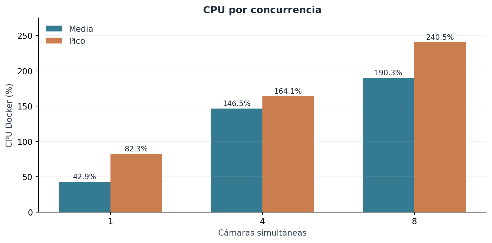
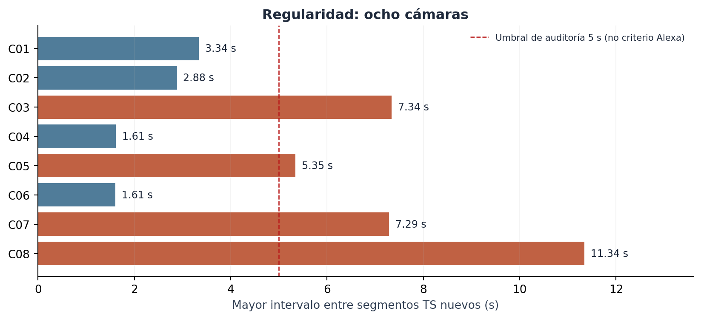

# Evaluación de rendimiento — 19 de noviembre de 2026

**Versión medida:** gateway Pro `0.2.0b1`. **Versión del wizard y adaptador de HA en este repositorio:** `0.3.0b1` (aún sin prueba de campo equivalente). **Entorno:** Ubuntu, Docker, 4 CPU lógicas, 7,1 GiB RAM, ocho canales RTSP de un mismo NVR. Todos los canales ensayados operaron en modo `transcode`.

## Diseño

- Concurrencia de 1, 4 y 8 canales; **una ejecución independiente por nivel**.
- Una ventana sostenida objetivo de 60 s tras detectar el primer segmento en todas las cámaras de la condición.
- 30 muestras de recursos Docker por condición (muestreo temporal de ~2 s): **no son 30 réplicas independientes**.
- Errores: HTTP y excepciones observadas por el cliente; no incluye análisis de fotogramas decodificados ni pérdidas internas del NVR.
- El cliente registra los segmentos TS distintos descargados y el mayor intervalo observado hasta descubrir un segmento TS nuevo.

## Resultados observados

| Canales | CPU media (%) | CPU pico (%) | RAM pico (MiB) | Primer TS media (s) | TS distintos | HTTP / otros | Apagado |
|---:|---:|---:|---:|---:|---:|---:|---|
| 1 | 42.90 | 82.31 | 104.1 | 4.224 | 61 | 0 / 0 | Sí |
| 4 | 146.47 | 164.12 | 338.6 | 6.599 | 253 | 0 / 0 | Sí |
| 8 | 190.26 | 240.52 | 678.7 | 11.474 | 511 | 0 / 0 | Sí |



El **100 % de CPU de `docker stats` equivale aproximadamente a una CPU lógica**, por lo que 190,26 % representa 1,90 CPU lógicas de media, no un desbordamiento. En el host de cuatro CPU lógicas, el 240,52 % pico equivale al 60,13 % de su capacidad nominal.

En la condición de ocho canales, **cuatro** registraron `max_gap_new_ts_s > 5 s`, con máximo 11,343 s. Es un intervalo detectado por el cliente de benchmark; **no equivale por sí solo a congelamiento de imagen**. La memoria aumentó desde 627,0 hasta 675,9 MiB entre la primera y última muestra sostenida de ocho cámaras; 60 segundos no permiten concluir fuga de memoria.



## Reproducir el análisis

Los CSV originales anonimizados, la tabla derivada, hashes, cinco figuras y el script de cálculo se encuentran en [`benchmarks/2026-11-19`](../benchmarks/2026-11-19/). En una máquina con Python 3 y matplotlib:

```bash
python3 -m pip install matplotlib
python3 benchmarks/2026-11-19/reproducir_analisis.py
```

Repetir la adquisición en un servidor autorizado requiere el gateway en ejecución, un entorno sin saturación previa y la herramienta:

```bash
python3 tools/benchmark_sostenido.py --concurrency all --duration 60   --admin http://127.0.0.1:18099 --hls http://127.0.0.1:18090
```

El script opera con **guardarraíles de CPU y memoria**. No lo ejecutes con cámaras de terceros sin autorización; evita interferir con servicios críticos. Para confirmar conclusiones científicas: tres o más repeticiones por condición, variación de orden de escenarios, 10–30 minutos de estabilidad, pruebas de decodificación y comparación controlada con otra solución bajo el mismo perfil H.264.

## Interpretación y límites

La medición demuestra **entrega HLS y liberación de procesos bajo demanda** durante los ensayos. No prueba que las ocho imágenes se vieran simultáneamente en Fire TV ni que la beta 0.3 supere otra implementación. El video público de Fire TV demuestra la instalación original; no reemplaza las pruebas end-to-end de esta versión.

Para más detalle técnico y valores individualizados, consulta [INFORME_TECNICO_2026-11-19.md](INFORME_TECNICO_2026-11-19.md). Revisa la política editorial antes de publicar borradores completos del manuscrito científico.
